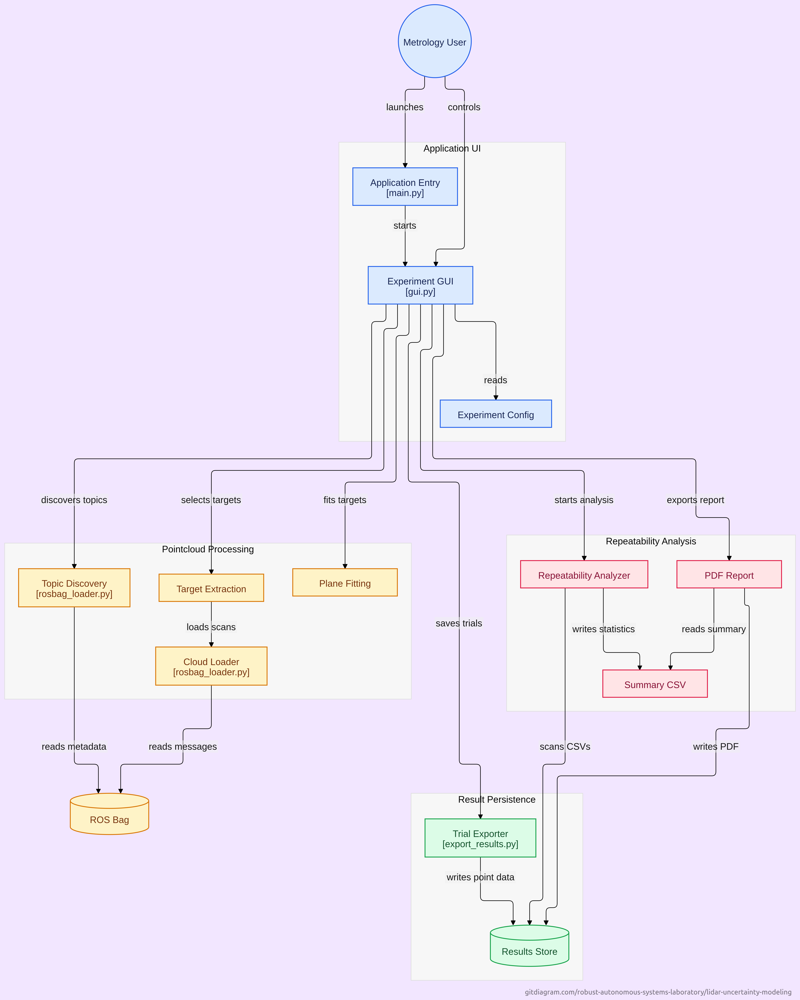
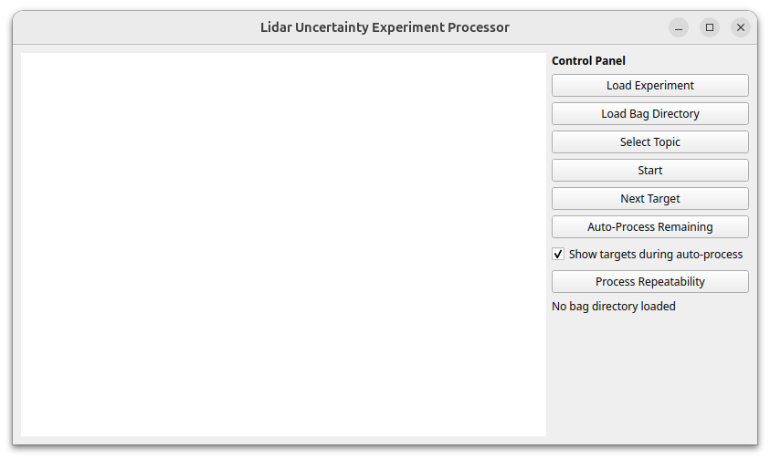
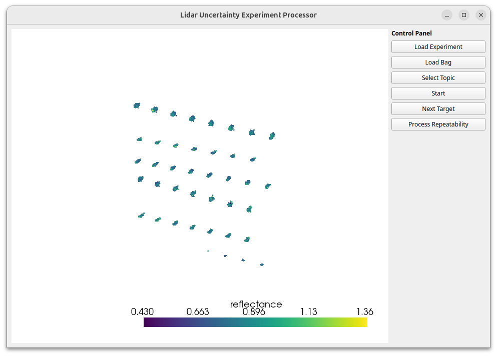

# Pointcloud Target Processing

A python package to extract planar target points from a pointcloud for automotive lidar metrology studies, calculate experiment repeatability, and evaulate the effect of adverse weather on lidar range statistics.

## Architecture

Point cloud pre-processing and statistics calculation is controlled by `gui.py`, which starts a PyQt application with PyVista graphing embedded for point cloud visualization. The accompanying diagram was generated with [https://gitdiagram.com](https://gitdiagram.com/)



## Installation

Clone the package:

```
$ git clone https://github.com/Robust-Autonomous-Systems-Laboratory/lidar-uncertainty-modeling.git
```

### Required packages

Make a new virtual env and source it:
```
$ cd lidar-uncertainty-modelling
$ python3 -m venv ./lidar_venv
$ source lidar_venv/bin/activate
```

Install dependencies from `requirements.txt`:
```
$ pip install -r requirements.txt
```

## Usage

Launch the GUI by running `main.py`

```
$ cd lidar-uncertainty-modelling
$ python3 main.py
```



### Experiment Configuration File
This application works off an experiment configuration file created by the practioner to define the test field. This defines planar target locations, sizes, reflectivities, etc. and is necessary for the processor to properly iterate through all targets.

Experiment descriptions are YAML files located in `/cfg`. An example is located in [`/cfg/test1_target_locations.yaml`](/cfg/test1_target_locations.yaml)

When ready to process lidar data, select the experiment you wish to process by selecting the "Load Experiment" button.

### Load Bag Directory
At present, this app only processes ROS1 bag files. Select the "Load Bag Directory" button and choose a directory containing the experiment's bags. Subdirectories are searched too, so a parent directory holding several test days can be selected at once.

Bags must be named `test##_lidar_name.bag`:

- `##` is the repeated trial number (e.g. `test7`, `test12`). It numbers the saved results, so each trial number should appear only once per lidar.
- `lidar_name` identifies a distinct lidar unit or operating mode (e.g. `vlp32_last`, `vlp32_strongest`, `ouster_1024x20`). All trials with the same `lidar_name` are processed together, in trial order, and reported as one sensor.

For example, `test3_vlp16_last.bag` is trial 3 of the `vlp16_last` lidar. Bags that do not follow this convention (e.g. `people.bag`) are skipped and listed in the terminal. The control panel summarizes the lidars and trial counts that were found.

### Select Topic
Each lidar's [PC2](https://docs.ros.org/en/noetic/api/sensor_msgs/html/msg/PointCloud2.html) topic is detected automatically when its bags publish a single PointCloud2 topic. For lidars that publish several (e.g. iris: `/pcl_combined_layer` and `/scan_line_combined_layer`), select "Select Topic" to choose one; you are asked once per lidar, not once per bag. If a topic has not been chosen, you are prompted when processing starts.

### Start Processing
Once all details are set, select the "Start" button to begin target planar processing. Bags are processed one lidar at a time, in trial order, and every target in the experiment is extracted from each bag. Iterative Recursive Least Squares (IRLS) is used to remove noisy target points and trim the outer edges of the planar target surface area due to range binning errors caused by sharp edges. The extracted target points are displayed on the left for visual confirmation, and the control panel shows the current lidar, trial, target, and overall progress.



### Next Target
If the target appears correct, select "Next Target" to save target information. After the last target of a bag, the next bag is loaded automatically; a message appears once every bag and target is processed.

If no points fall inside a target's search volume (for example, a target outside a lidar's field of view), the display says so and "Next Target" moves on without saving anything for that target.

### Auto-Process Remaining
To process without reviewing each target, select "Auto-Process Remaining". Every remaining target of every remaining bag is extracted and saved, starting from the current position, so you can review a few targets manually first and then let the rest run. Targets with no points are skipped. Select the button again ("Stop Auto-Process") to stop after the current target; the display then shows where processing stopped, and you can continue manually or resume auto-processing.

Each auto-process run writes `auto_process_log_<date>_<time>.csv` to `results/<experiment>/`, listing every lidar/trial/target with whether it was saved or skipped (and why) and the number of points saved, so unreviewed extractions can be audited.

### Saved Results
Extracted target points are saved to `results/<experiment>/<lidar_name>/<target>/` as `inner_planar_target_points_<##>.csv` and `.vtk`, numbered by the bag's trial number, along with `point_counts_per_scan_<##>.csv`. Re-processing a trial overwrites its files. Each point includes its `calculated_range`, its signed orthogonal distance to the fitted target plane (`plane_distance`), and its offset from the plane measured along its own beam (`range_residual`).

### Process Repeatability
When all bag files for a given experiment are processed, select the "Process Repeatability" button to generate a repeatability report that evaluates Type A uncertainties for each lidar. A summary CSV and PDF report are stored in `results/<experiment>/`.

Repeatability s<sub>r</sub> is the standard deviation of each point's `range_residual`: its range offset from the fitted target plane, measured along that point's own beam. This removes the geometric range variation across the face of a target that is not square-on to the lidar, while keeping s<sub>r</sub> in true range units. Range residuals are measured from the point cloud origin, so they assume the sensor sits at that origin. Results saved before `range_residual` was exported are handled by refitting a plane to the saved points.

The report contains:

- **Repeatability by target**: one chart per target, titled with the target's name and serial number (plus nominal range and reflectivity), plotting repeatability s<sub>r</sub> (y) against mean distance offset from the target's nominal range in mm (x). Each trial is a small faint dot; each lidar also has one bold marker at its average offset and pooled s<sub>r</sub>, with a horizontal bar spanning ± pooled s<sub>r</sub>. All charts share one s<sub>r</sub> scale, and the x-axis is centred on the nominal distance. Only the lidars listed in `REPORT_CHART_LIDARS` in `src/gui.py` are charted (by default `ouster_2048x10`, `vlp32_strongest`, `ruby` and `iris`); set it to `None` to chart every lidar. If none of the listed lidars are in the results, every lidar is charted and the report says so. Each charted lidar keeps the same colour and marker in every chart and is named in the chart's key. A target with no data from the charted lidars gets a note instead of a chart.
- **Pooled summary** for each lidar.
- **Targets**: each target's name, serial number, nominal range, reflectivity, size, and description from the experiment YAML. The serial number is read from a `serial_number` key if present, otherwise from `SN <number>` in `other_info` (e.g. `other_info: Labsphere SN 0121252683`).
- **Statistics by target**: one table per target, headed with its name, serial number, nominal range and reflectivity, with a row per lidar listing its number of trials, total points, mean range, pooled s<sub>r</sub> (degree-of-freedom weighted within-trial repeatability), trial-to-trial s (standard deviation of the trial mean ranges), and maximum U<sub>95</sub>. Every lidar is included, not only the charted ones. A target with no data says "No points or statistics for this target", and a note under each table names any lidars with no data for that target. These statistics are also saved as `lidar_repeatability_summary_per_target.csv`.
- **Appendix**: the per-trial breakdown for every lidar, target, and trial.

An example of this report is located here: [`/results/12_target_test/lidar_repeatability_summary.pdf`](./results/12_target_test/lidar_repeatability_summary.pdf)

## To Do
Several functional updates are planned for the future of this processing application, including:

- Robust user interface to catch out-of-order errors
- Expanded data input types, including bag2 and PCDs
- Option of including user inputted Type B uncertainty to the repeatability report
- Addition of processing data with an additional variable (i.e. weather) and conduct a t-test against the repeatability report

## Related
This processing pipeline __supercedes__ an initial experiment processing architecture, located at https://github.com/Robust-Autonomous-Systems-Laboratory/open-lidar-evaluation

## Acknowledgement
This work is supported by the United States National Institute of Standards and Technology (NIST) Grant 60NANB24D227.

## Contact

Ian Q. Mattson, iqmattso \<at\> mtu.edu
